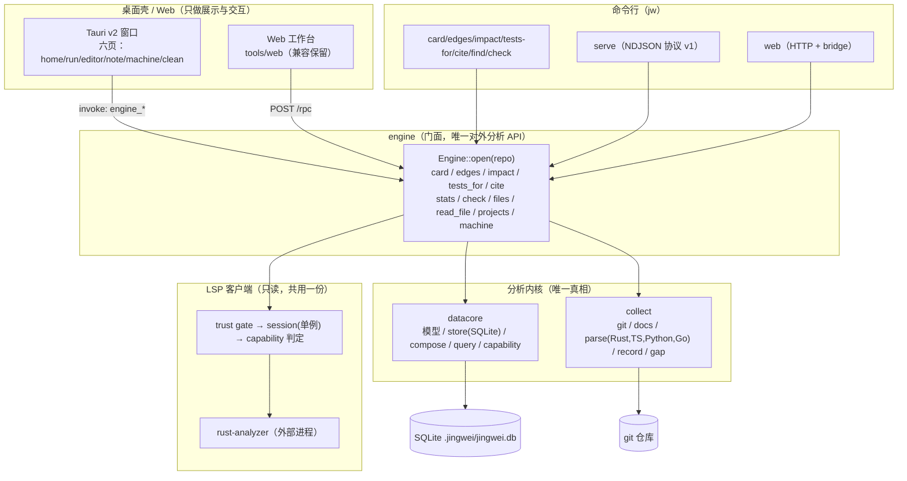
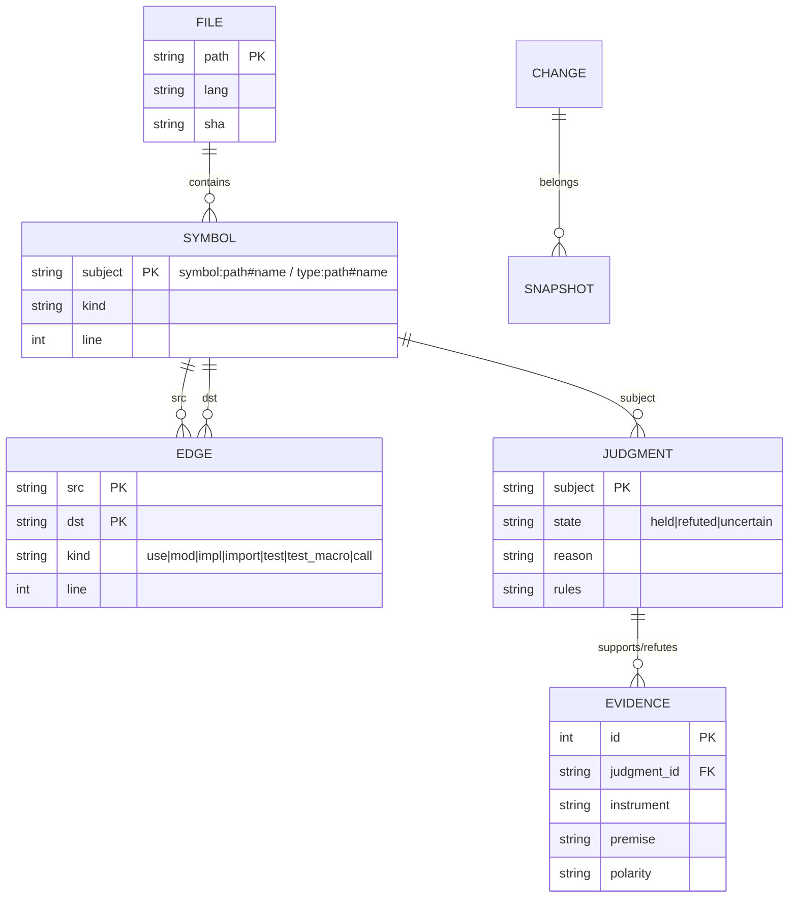
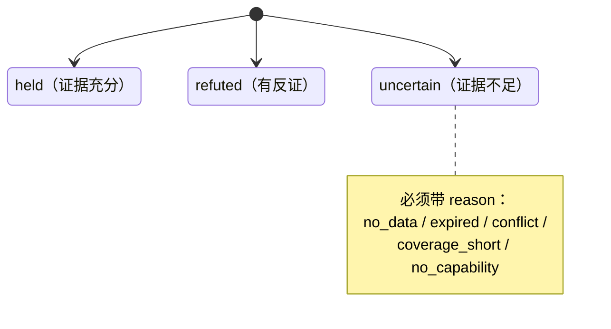
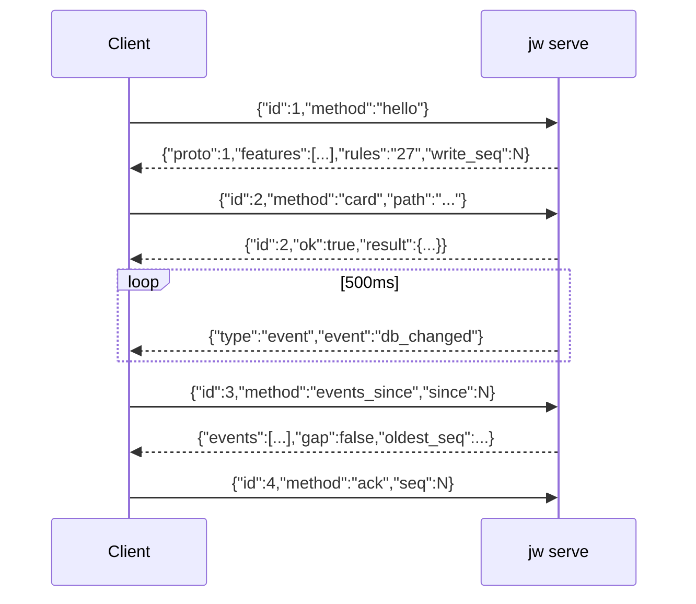
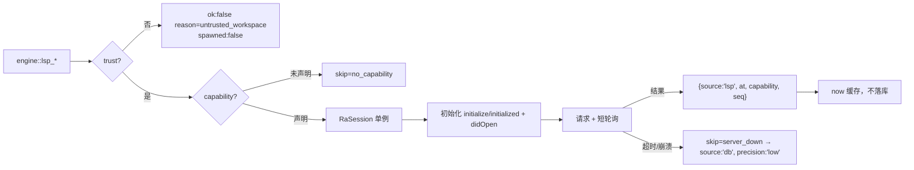
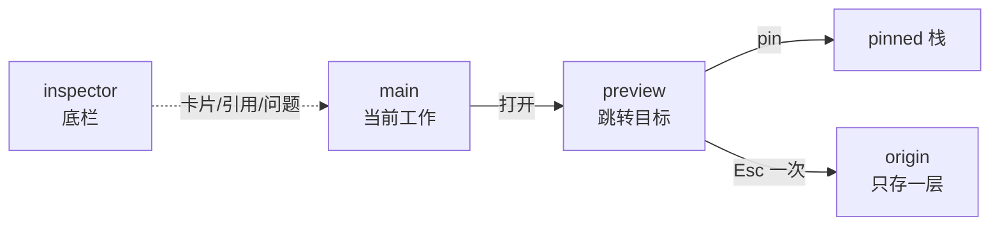
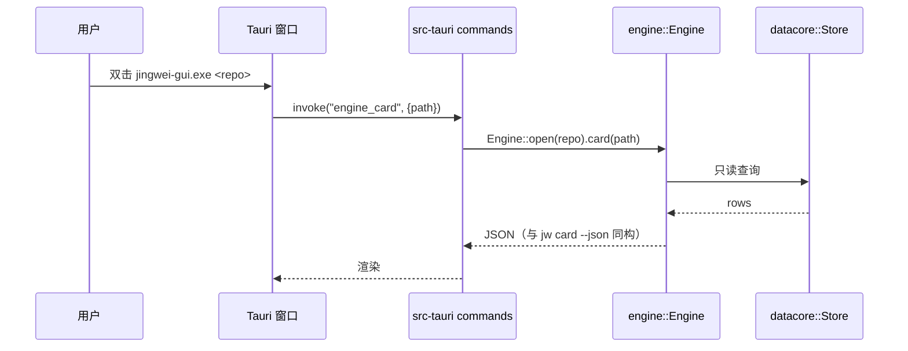

# 经纬（jingwei）最终态完整设计 · 架构 · 决策记录

> 版本基线：`jw 0.4.0 (rules 27)` ｜ 文档日期：2026-10-27 ｜ 状态：0.4.1-rc 前夜
> 本文是"最终态"的完整图景：**产品定位、原则、架构、数据模型、判定模型、协议、LSP、UI/UX、壳与引擎的边界、质量体系、发布、路线图、决策记录、风险**。
> **本文是"目标态"**；**"当前态"只认 `HANDOFF.md` 与 `.pro/exp/out/` 证据**。
> 冲突裁决顺序：**代码与证据 > HANDOFF > 本文**。
> 单一真相：`HANDOFF.md` + 本文（目标态）+ `session-handoff-2026-10-27.md` + `.pro/exp/out/`。

---

## 0. 一句话

**经纬是一个"可验证的代码理解工具"**：它不替人猜，而是把"关于代码的判断"连同证据、边界、失败原因一起呈现；
桌面壳（Tauri）负责"看得懂、点得动"，内核（datacore/collect）负责"算得准、说得清"。

产品三档定位：**作品集 > 产品 > 商品**。因此取舍一律偏向"可复跑、可解释、可维护"，而不是功能数量。

---

## 1. 设计原则（不可协商）

| # | 原则 | 含义 | 反例（禁止） |
|---|---|---|---|
| P1 | **三态，不二值** | 判定只有 `held / refuted / uncertain`；`uncertain` 必须带理由 | 用"没找到"冒充"不存在" |
| P2 | **证据先于结论** | 任何结论都要能指到 evidence/edge/位置 | 模型口头推断当证据 |
| P3 | **只读优先** | 分析层只读；写操作（rename/apply）默认不做 | 分析命令偷偷改文件 |
| P4 | **壳核分离** | 壳只管 UI/交互；分析只在 `datacore`+`collect` | 壳里再实现一套索引 |
| P5 | **一处实现** | 同一能力只有一份实现（CLI / serve / 壳共用 `engine`） | 两份 LSP / 两份 card |
| P6 | **失败要显式** | 降级必须 `skip` + `source` + `precision`；不静默 | 空数组当"没有" |
| P7 | **安全默认关** | 未信任不 spawn、外部操作 deny、单实例 | 双击弹一堆窗口 |
| P8 | **可复跑** | 每个结论有命令 + 数字 + 文件 | "我验证过了" |

---

## 2. 总架构



**边界规则**
- 壳（Tauri）**不允许**直接读 SQLite、不允许自己解析代码；只能调 `engine_*`。
- `engine` 是**唯一** facade；CLI、serve、壳三者行为必须一致（同输入同输出）。
- LSP 结果**只进 now 缓存**，不写 judgment/edge/evidence/history。

---

## 3. 仓库与目录

**引擎源（唯一分析源）**

```
D:\projects\jingwei
  Cargo.toml                  # workspace
  crates/
    datacore/                 # 模型 + store + 查询 + 组合
    collect/                  # git / 文档 / 解析 / 记录 / 缺口
    engine/                   # 只读门面（CLI/壳共用；T2 新增）
    lsp/                      # LSP 客户端（计划 T6，共用一份）
    cli/                      # bin jw（CLI + serve + web）
  tools/web/                  # web 工作台 + smoke
  scripts/                    # package.ps1 / check-split.ps1
  docs/reference/             # architecture/frontend/serve-protocol/lsp-matrix/ui-spec/sop
  .pro/exp/                   # 实验原始证据（不入发布包）
```

**产品壳**

```
D:\projects\jingwei-shell
  ui/                         # 12 个文件（已删 graph.js）
  src-tauri/                  # 旧内核（T5 逐个替换后删除）
```

**只读参考**

```
D:\jingwei-archive-20261024\jingwei   # 0.3.0，禁止修改
```

## 4. 数据模型



**Subject 规范**：`file:<rel>`、`symbol:<rel>#<name>`、`type:<rel>#<name>`（impl 源统一用 type）、`test:<rel>#<name>`、`range:<rel>:<a>-<b>`、`doc:<rel>`、`dep:<name>`。

---

## 5. 判定模型 Γ ⊢ J



- 规则集版本 `PARSE_RULES_VERSION=27`；rules 变化 → 边重建。
- 边的三种精度来源：解析（`parse`）、调用解析（`call`）、LSP（只读，不落库）。
- 关键裁决：**调用图不依赖 LSP**（离线可用）；LSP 只用于 hover/def/refs/hints/actions 的即时查询。

---

## 6. 查询面（view 投影）

| 命令 | 输入 | 输出（要点） | 证据 | 状态 |
|---|---|---|---|---|
| `jw card` | 文件/符号/范围/模块/依赖 | `state/verdict + groups + edges + tests + history` | judgments/evidence/edges | 已实现 |
| `jw edges` | 文件/符号/`--to`/`--stats` | 出边/入边/种类统计 | edge 表 | 已实现 |
| `jw impact` | 符号/文件/范围 | 反向闭包 + 受影响测试 | call/use/test 边 | 已实现 |
| `jw tests-for` | 文件/符号 | 可达测试列表（含不确定） | test 边 | 已实现 |
| `jw cite` | 符号/文件 | permalink（commit + 行号） | git blame + 表 | 已实现 |
| `jw find` | 关键词 | 文件/符号/证据命中 | FTS + 表 | 已实现 |
| `jw check` | repo | 12 项计数（含 `lsp_in_history=0`） | 全库 | 已实现 |

输出必须是**稳定 JSON**（供 SHA 回归）：字段顺序、排序、`null` 语义固定。

---

## 7. serve 协议 v1



- 方法：`hello / events_since / ack / card / edges / find / impact / tests_for / cite / check / stats / projects / files / read_file / machine / lsp_*`。
- 未知方法 → `ok:false`，进程存活。
- 事件环：`REPLAY_CAP=256`、`RING_CAP=1024`；`db_changed` 由 `write_seq` 轮询触发。

---

## 8. LSP 子架构（只读）



**六能力**：`diagnostics(pull) / hover / definition / references / inlayHint / codeAction(只展示)`。
**硬不变量**：`check` 第 12 项 `lsp_in_history=0`；未信任 0 spawn；进程树 `taskkill /T /F`；`source` 只允许 `lsp|db|sys`。

---

## 9. UI/UX 设计

### 9.1 信息架构（六页，graph 已删）

```
┌──────────────┬───────────────────────────────────────────────┐
│ 左栏（导航）  │ 主区（main）                                   │
│  home        │  概览：结论 / 待处理 / 项目健康                  │
│  run         │  运行：命令、输出、失败行（终端，P1）             │
│  editor      │  编辑器：文件树 / 代码 / 问题 / hover / 引用      │
│  note        │  记录：文档 / 笔记 / 运行日志                    │
│  machine     │  机器：OS/CPU/内存/环境                         │
│  clean       │  清理：可删 / 需权限 / 别碰（check 十二项）      │
└──────────────┴───────────────┬───────────────────────────────┘
                               │ 右 dock：preview（+ pinned 栈）
                               │ 底部 inspector（卡片/引用/问题/终端）
                               │ 状态栏：repo · rules · write_seq · RA
```

### 9.2 四槽与跳转模型



规则：**一跳=替换 preview**；`origin` 单层；`history≤2`；多目标先出候选、选中仍算一跳；`Esc` 回 origin；禁止嵌套跳转。

### 9.3 交互契约

| 交互 | 触发 | 结果 | 降级 |
|---|---|---|---|
| hover | 停留 300ms | 380px 卡：type/doc + `source: lsp` | `类型未知` + `db` |
| definition | 双击/`g` | 单目标替换 preview；多目标候选 | `precision: low` |
| references | `r` / 行尾 | 按文件分组、点击一跳 | `coverage{resolved,unresolved}` |
| inlayHint | `Alt+H` | 可视区、150ms 去抖、上限 200、stale 丢弃 | 不显示，badge `db` |
| codeAction | Problems 行 | chips 只展开，**不 apply** | 无 chips |
| 主题 | 设置/`?theme=mc` | 双主题，bbox 不变 | — |

### 9.4 视觉

- 默认"密"主题；Minecraft 风可切换；`--bw/--radius` token 化，切主题不改布局。
- 状态用形状 + 颜色双编码（三态不只靠颜色）。
- 键盘优先：`/` 搜索、`1-4` 槽、`Enter` 打开、`p` 钉、`Esc` 返回、`Alt+H` hints、`r` 引用。

---

## 10. 壳与引擎的边界（Tauri）



- 壳内旧内核（graph/scan/projects/...）按 T5 顺序**替换后删除**，最终 `src-tauri/src` 只剩 `main/lib/commands/trust/lsp`。
- 外部操作（`open_in/open_path/open_url/shell/pick_folder/launch_project/run_task/apply_*`）**deny-list**：JS 层 + Rust command 层双保险；UI 显示"未实现"。
- 单实例：回环端口互斥；第二实例 exit 2；窗口数证据写 `%TEMP%\jingwei-gui-windows.txt`（必须为 1）。

---

## 11. 安全与隐私

| 面 | 措施 |
|---|---|
| 信任 | 用户级 `%APPDATA%/jw/trust.json` + `audit.log`；未信任 0 spawn |
| 进程 | 无 shell 拼接；`env_clear` + 白名单；`taskkill /T /F`；单实例 |
| 外部程序 | deny-list（双端）+ capabilities 最小 |
| 数据 | 仓库内不写信任库；LSP 不落库；`lsp_in_history=0` |
| 发布 | dist 只带 gui/CLI/docs；不带 bench/docs-shots/skills |

---

## 12. 质量体系

```
单元/集成: cargo test --workspace                 （247 passed）
fixture  : card/edges ×3 仓 SHA 3/3 等
UI       : smoke --shell（headless DOM，6 tabs，11 checks）
LSP      : smoke --lsp-gate/diag/real/hover/def/ref/hint/action
文档     : b94_docs_consistency.py（版本/数字/sha 同源）
门禁     : gate-control.ps1（rg/tauri/nushell 三仓 ok，对称差 0/0）
拆分     : scripts/check-split.ps1（tests + 3 SHA + 版本 + 行数 + 警告）
打包     : scripts/package.ps1（内容清单 + ASCII + architecture hash + zip sha）
```

原则：**红就是红**；flake 不放过；SKIP ≠ PASS；截图/文件必须新鲜。

---

## 13. 发布

- 版本：`0.4.x`；`rules=27`；`jw --version` 与包内文档一致。
- 包名随版本：当前 `0.4.1-rc` → `dist/jingwei-v0.4.1.zip`（gui + CLI + docs + web/ui），`.sha256` 同目录；`m14.json` 记 tests/smoke/gate/v1/sha。
- 标签：GUI 未人工验收时标 **`0.4.1-rc` / "GUI 运行未验"**；用户手动双击通过才去 rc。

---

## 14. 路线图（pro 派发顺序）

| 任务 | 内容 | 验收 |
|---|---|---|
| T2.3 | `card_value` + 最小助手 → `engine::view`；cli 只改调用 | 3 SHA 3/3、247 绿、warnings≤124、版本不变 |
| T2.4 | `Engine::open` / `module_map` + 只读命令面 | `cargo test -p engine` |
| T3 | shell 加 path dep，`engine_*` 与旧命令并存 | 双 build 绿 |
| T4 | 六页逐个切真数据 | 每页 ≥1 真数据 |
| T5 | 删旧内核（graph→scan/projects/machine/notes/run），每删一 build | 双 build 绿、grep 无旧命令 |
| T6 | impact/tests_for/cite/problems + `crates/lsp` 共用 | fixture 单测 |
| T7 | 单实例 + deny-list + 窗口数证据 | 人工一次开窗=1，关窗 PID=0 |
| T8 | 打磨 + `0.4.1-rc` 打包 | 全量验收 + sha 同步 |

P1：终端底栏（cwd 跟随）、布局/会话恢复、行内 git blame、外部改动重载、键盘选择复制、命令面板。
P2：鼠标组合键、终端点路径、scrollback 搜索。

---

## 15. 决策记录（ADR 摘要）

| ID | 决策 | 理由 | 代价 |
|---|---|---|---|
| ADR-1 | 壳用 Tauri v2（不用 wry） | 底座现成、UI/UX 成熟 | 依赖较重 |
| ADR-2 | 引擎整块替换为 datacore+collect | 旧内核不够坚实 | 迁移工作量大 |
| ADR-3 | 画图全砍 | 不是核心价值，维护贵 | 少一个卖点 |
| ADR-4 | LSP 只读、六能力 | 价值高、风险可控 | 不做 rename |
| ADR-5 | 外部操作 deny-list | 防窗口风暴/越权 | 部分功能暂缺 |
| ADR-6 | 一处实现（engine facade） | 防 CLI/壳漂移 | 改造期双轨 |
| ADR-7 | 三态判定 + 证据 | 产品灵魂 | 实现更重 |
| ADR-8 | 发布含用户路径验收 | CLI 可用≠用户可用 | 验收更慢 |

---

## 16. 风险与已知限制

- **GUI 运行未验**：只做了 headless DOM；用户实机曾出现多窗口（已加 deny-list/单实例/窗口数证据，待人工复核）。
- **39 个 UI 命令未映射**（静态；加载触发约 12）：UI 显示"未映射（M15）"。
- 六页中 run/note 仍为部分数据；终端底栏未做。
- `main.rs` 未拆（6,490 行 → 目标 <800，check-split 已就绪）。
- LSP 依赖外部 RA；无 RA 时降级（显式 skip）。
- 跨仓/联网/rename 明确不做。

---

## 17. 术语表

| 词 | 含义 |
|---|---|
| Subject | 被判断的对象（file/symbol/type/test/range/doc/dep） |
| Judgment | 关于 Subject 的三态结论 + 理由 |
| Evidence | 支撑/反驳判定的证据行（instrument + premise + polarity） |
| Edge | Subject 之间的关系（use/mod/impl/import/test/call） |
| now 缓存 | 只读即时结果（LSP），不落库 |
| skip | 显式降级原因（no_server/server_down/no_capability/...） |
| 四槽 | main / preview / pinned / inspector |
| rules | 解析规则版本（27），变化触发重建 |

---

## 18. 运行时契约（目标态；标 [rc] 的进 0.4.1-rc）

- [rc] 18.1 **壳内同步 DB 调用必须离开 async 线程**：Tauri command 里 `Engine::*`（rusqlite 同步）一律经 `spawn_blocking`；CPU 密集（AST/闭包）同。
- [rc] 18.2 **子进程 stdout/stderr 持续排空**（LSP/CLI/serve 三处），结束 `taskkill /T /F` 并按 PID 树复查 0。
- [rc] 18.3 **NDJSON 每条写完 flush**；坏行丢弃 + warn，不 unwrap。
- [rc] 18.4 **弱仓体检**：浅克隆/detached HEAD 在 `Engine::open` 检出 → `cite` 降级 `skip=shallow`，不 panic。
- [rc] 18.5 **LSP 未就绪返回 `uncertain(lsp_warming_up)`**，不得返 `no_data`（P1）。
- 18.6 监听：notify + 300ms 防抖，忽略 `.git/target/node_modules`；rename 区分"保存"与"删除"。
- 18.7 指纹 = 文件 SHA + rules 版本（**不含**编译器版本）；规则变更触发边重建。
- 18.8 反向依赖：符号改名/删除 → 引用方即使内容未变也重算，绝不留僵尸边。
- 18.9 SQLite：WAL + `wal_autocheckpoint`；写收敛单线程批量事务；读不饿死写（busy_timeout 2s）。
- 18.10 日志 `%APPDATA%/jw/logs` 按天；panic hook 落盘 + CLI 非零退出。
- 18.11 配置三层（全局 / `.jingwei/config.json` / env），标注热/冷重载（主题热、LSP 开关冷）。
- 18.12 大 payload：列表接口带 `limit/offset`；大文件用 `read_file_range`；二进制 IPC 用 Uint8Array。

## 附录 A：工程暗坑（2026-10-27，全部本轮真实踩到，带证据）

1. `String::truncate` 非字符边界 **panic**（serve read_file 原样）→ 只读前 N+4 字节 + `is_char_boundary` 回退。
2. `store.count("<表>")` 有白名单（store.rs:2229），白名单外的 `unwrap_or(0)` → **恒 0**（serve stats files/symbols 长期 0）。
3. INNER JOIN 吞悬空行 → 安全不变量假 0；用 LEFT JOIN + `ifnull`，并用 `foreign_keys=OFF` 直插造红测。
4. `read_dir(root.join(rel))` **无越界检查**（serve files）→ 传 `..\..` 可列仓库外；canonicalize+starts_with 必做。
5. tree-sitter 有 `links="tree-sitter"`，**全图只能一版**；靠"语法包不依赖 core（只依赖 tree_sitter-language）"实现版本收敛。
6. `shutil.copy2` 保留旧 mtime → "停手门/mtime 判活"会失效；一律用 **sha256**。
7. cargo test/build 并行 → binary 被占用 → **假红**（97 passed + SPLIT_FAIL）；门禁不并行。
8. `pub fn store()` 把 Store 交给壳 = 壳可写库，破 doc:78 边界。
9. 状态写进代码注释（"2.3a 已回滚"）＝假台账；状态只进 HANDOFF。
10. 备份时机错：应"改前复制 + 改后立刻双备份 + 校验字节数/sha"，而不是"稍后再存"（467 行差点丢）。

### 15.1 ADR 增补（2026-10-27）

| ID | 决策 | 理由 | 代价 |
|---|---|---|---|
| ADR-9 | tree-sitter 收敛 0.27 单版 | links 冲突无解，只能一版；语法包不动故 parse 树不变 | 主仓 core 升级 |
| ADR-10 | facade 契约 = serve `result` 内层 | CLI/serve/壳同输入同输出（doc:79） | 信封由调用方加 |
| ADR-11 | check 12 项为唯一真源 | doc:195/258；serve 4 项 stub 废弃 | 旧 UI 显示变化 |
| ADR-12 | 安全不变量必须"能红" | lsp_in_history 长期假 0 的教训 | 每条不变量配违规构造测试 |
| ADR-13 | 静默降级零容忍 | 3 个实例（stats/lsp/read_file） | T2.5 全仓审计 |

### 16.1 差距表（当前态 vs 目标态，2026-10-27）

| 项 | 当前 | 目标 | 何时 |
|---|---|---|---|
| main.rs 行数 | 5,431 | <800 | T8（不在门里，未达须如实标） |
| shell 旧内核 | src-tauri 54 处 `jingwei_engine` + 4 个 crate | 只剩转接层 | T5a/T5b |
| UI 命令映射 | 84 invoke / 7 死命令 / 39 未映射（doc:394） | 六页全真数据 | T4 |
| GUI 验收 | headless DOM only | 人工一次开窗=1、关窗 PID=0 | T7 |
| LSP 进程树 | taskkill /T | Job Object | T7 |
| 统计口径 | stats/check 已接 facade | 壳显示同源 | T4 |
| edges 口径 | 11 结构边（use/mod/impl，UI 显式标注） | 58 全量（含 call/test） | T6 |
| `#railProjs`（启动历史） | 空 div（display:none） | T6/T8 决定实现或删除 | —— |
| note 写入（event_note/save_note/delete_note） | 已删 | T6 若恢复需接新库 | —— |
| 项目创建（create_project） | 已删 | ADR-5 deny | —— |
| 草稿/应用（apply_edit/snapshot_file/restore_draft/contract_save） | 已删 | P3 只读优先 | —— |
| 配置档（profiles） | 已删/T6 | 旧路径 %LOCALAPPDATA%\jingwei | T8 三层配置时再设计 |
| 默认编辑器偏好（default_opener/set_default_opener） | 已删/T6 | 写旧 LOCALAPPDATA 设置 | 外部操作偏好，P7 deny |
| 状态栏实时 CPU/内存采样 | T6 | 旧内核 sys::machine 180-250 行 FFI + windows-sys，不进壳；将来在 engine 实现 | —— |
| 编辑器检测（detect/App） | T6 | 150 行注册表+PATH 扫描；无打开能力后价值低，T6/T8 在 engine 侧实现 | —— |
| impact 符号级反向闭包 | **已验**：fixture（a() 调 b()）parse 后 `direct` 非空且为符号级（`symbol:src/a.rs#a` → `symbol:src/b.rs#b`） | 无差距（主仓 `card` 的 direct 空是选样问题，不是 call 边缺失） | —— |

### 18.1 外部工程建议的处置（2026-10-27，用户转来 31 条）

- **rc 前必做 5 条**：5 异步隔离、13 stdio 排空、14 NDJSON flush、15 弱仓体检、23 LSP warming_up。
- **纳入目标态（T4–T8）**：1 监听/防抖、3 反向依赖、4 WAL/单写、6 日志/panic、7 配置三层、8 性能预算、9 生命周期、10 Job Object、11 schema 迁移、12 大 payload、18 路径归一（补大小写）、19 锁纪律、20 STRICT 表、21 FTS5 拆词、22 AST 显式栈、24 now 缓存键、25 降级链、27 证据链默认收起、28 单激活卡。
- **已覆盖**：14 flush（复核即可）、17 symlink 防护（T2.4 已做）、29 不自动 apply、30 文档/实况不符（T5b 已裁）、31 外部验证（check-split）。
- **否决 4 条**：2 指纹加编译器版本（应由 rules 表达）、16 GBK/encoding_rs（rc 只做 BOM 嗅探）、26 壳后置/CLI 优先（与六页 GUI 方向冲突；MCP 可作 T8 后增量）、31 的 agent 流程项（不进产品文档）。

