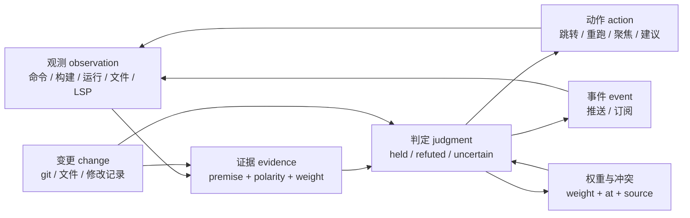
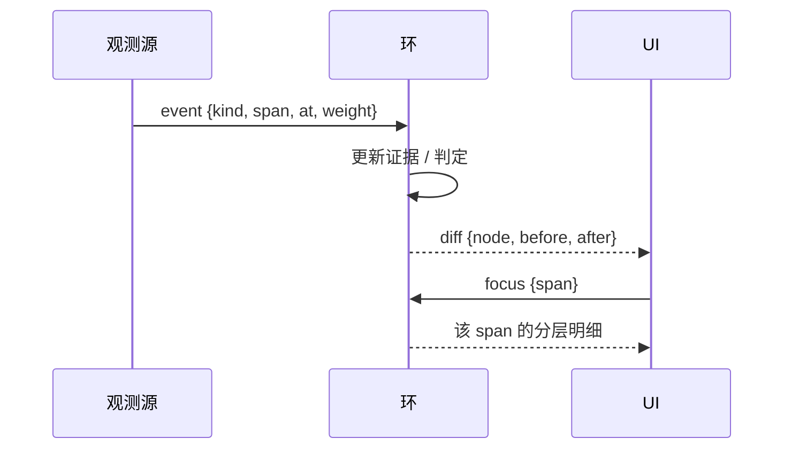
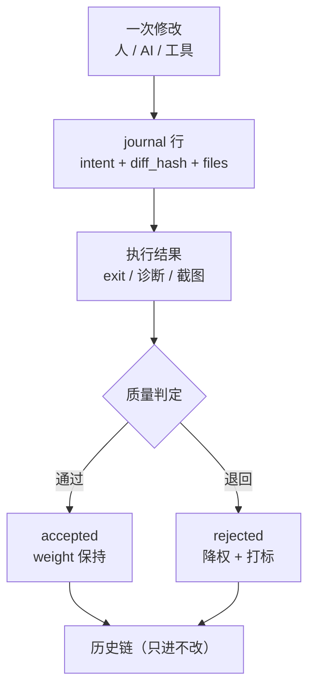
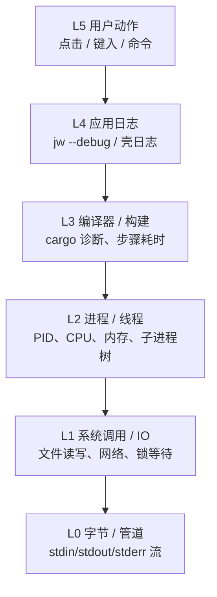
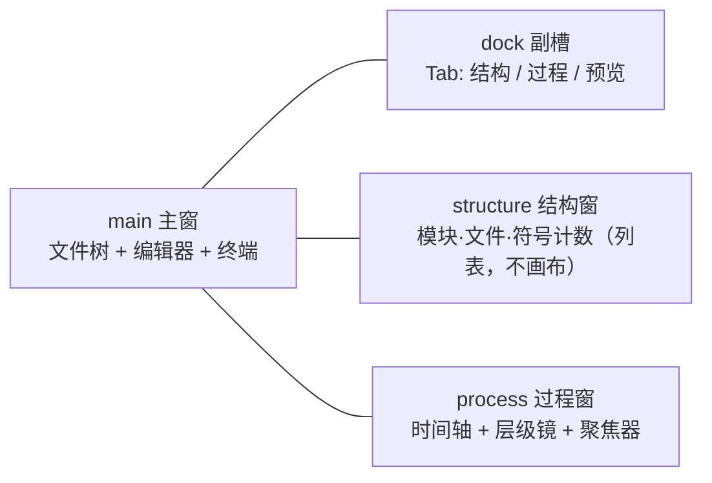
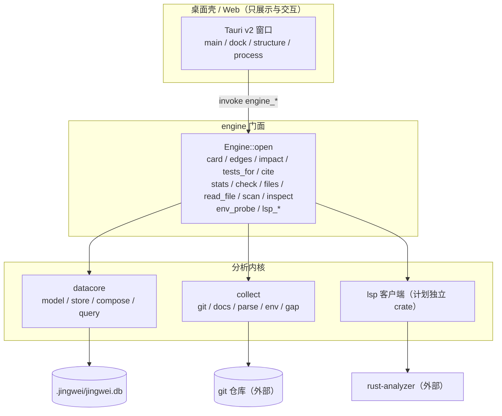

# 经纬（jingwei）· 设计实现总稿（2026-10-28 重写版）

> 版本基线：`jw 0.4.1 (rules 27)` ｜ 文档日期：2026-10-28 ｜ 状态：拆解重建中
> **本文取代 2026-10-27 版**（旧版归档于 `docs/reference/_archive/`）。旧版的 §18 运行时契约、附录 A 暗坑、差距表、ADR 增补**已并入本文 §9 / §14 / §12 / §15**，未丢项。
> **当前态只认** `HANDOFF.md` 与 `.pro/exp/out/` 证据；**目标态**认本文。
> 冲突裁决顺序：**代码与证据 > HANDOFF > 本文**。
> 图（mermaid）按代码对待：改图 = 改契约，必须同步改判据与测试。

---

## 0. 一句话与定位

**经纬是一个"能跑起来、看得见过程、判断有据"的本地开发工作台。**
它不替开发者猜结论，而是把"关于代码与构建的判断"连同**证据、权重、失败原因、可观测过程**一起呈现，并且**随时能跑**。

定位三档：**作品集 > 产品 > 商品**。取舍偏向可复跑、可解释、可维护，而不是功能数量。

**与 10-27 版的关键差异**：旧版定位是"可验证的代码理解工具"（静态理解 + 图谱）；本版定位是**工作台**——写码、构建、测试、运行、诊断、观测是主线，静态理解是其中的判断层。**图谱画布不是产品形态**（§7 / ADR-3）。

---

## 1. 从"重写失败"里学到的六条（都有当天证据）

| # | 失败 | 证据 | 现在的规矩 |
|---|---|---|---|
| E1 | 把"UI 是否还调用"当删除判据，删掉 `scan/list_projects/inspect` → 用户打开软件没有项目可点 | T5 分诊表、HANDOFF 15:00 段 | 删除决策多一问：**这是不是用户打开软件第一眼要走的路径** |
| E2 | 验收只断言"页面里有没有这段文字"，31 条全绿而产品不可用 | 上一轮 `smoke 31/31` 与实机对比 | 验收必须有一条**端到端用户路径**（输入→动作→结果） |
| E3 | pro 只看执行器自述，没核过一张运行截图 | 本轮往复 | **截图与日志由 pro 逐张核**，不接受"PASS"字样 |
| E4 | 测试数用"手工加前 N 条"得 213，真值 247 | `t2-baseline.txt` 沿革 | 数字一律**整份日志/脚本求和**，口径写死 |
| E5 | 门禁与其它 cargo / `jw.exe` 并发 → 假红 4 次 | `t31-*`、`t33_gate_red.py` | 门禁前断言 `jw/jingwei-gui/rust-analyzer` 进程=0，忙则 `exit 2` |
| E6 | 唯一副本在删除瞬间被覆盖（467 行 view.rs 丢过一次） | `.pro/bak/` 沿革 | 改前备份 + 改后立刻双备份 + 校验字节数/sha |

---

## 2. 设计原则（8 条，不可协商）

| # | 原则 | 含义 | 反例（禁止） |
|---|---|---|---|
| P1 | **三态，不二值** | 只有 `held / refuted / uncertain`；`uncertain` 必须带理由 | 用"没找到"冒充"不存在" |
| P2 | **证据先于结论** | 结论能指到 evidence/edge/位置/命令输出 | 口头推断当证据 |
| P3 | **只读优先** | 分析层只读；写操作（rename/apply/install）默认不做 | 分析命令偷偷改文件 |
| P4 | **壳核分离** | 壳只管交互；分析只在 datacore + collect + engine | 壳里再实现一套索引 |
| P5 | **一处实现** | 同一能力只有一份实现（CLI / serve / 壳共用） | 两份 LSP、两份 card |
| P6 | **失败要显式** | 降级必须 `skip` + `source` + `weight` | 空数组当"没有"、`unwrap_or(0)` 吞错 |
| P7 | **安全默认关** | 未信任不 spawn、外部操作 deny、单实例、窗口 ≤4 | 双击弹一堆窗口 |
| P8 | **中心不是核心** | `judgment` 是**中心**不是顶端：所有数据绕它循环（§3） | 把判定做成树根、单向推导 |

---

## 3. 核心抽象：judgment 为中心的环形网络

### 3.1 节点与环



**环上四条边**：观测→证据→判定→动作→（回到）观测；变更同时喂证据与判定；判定自带权重与时间，参与下一轮裁决。

### 3.2 为什么是环而不是树

- 树假定"结论一旦产生就固定"；环允许**新观测推翻旧判定**，且推翻本身留痕（§4.2）。
- 消息推送不是"从根广播"，而是**环上事件的订阅**：谁关心哪类事件就订哪条边，避免全量刷新。
- UI 刷新粒度 = 环上最近一次变化，不是整页重算。

### 3.3 消息模型



**硬约束**：事件必须带 `at`（unix 秒）与 `span`（可定位），否则无法回放；UI 只做 diff 合并，不做全量重绘。

---

## 4. 数据模型与权重分级

### 4.1 四层权重

| 层 | 来源 | 权重 | 举例 | 谁能推翻它 |
|---|---|---|---|---|
| **L1 一手** | 本机直接观测 | **1.0** | 命令退出码、stdout、文件内容 sha、git 事实、进程表 | 只有新的一手观测 |
| **L2 核心模型** | datacore 合成（compose） | **0.7** | held/refuted/uncertain、覆盖率、冲突对 | L1，且必须留痕 |
| **L3 外部工具** | LSP / 编译器 / 外部服务 | **0.4** | RA 诊断、hover、引用、DB 版本 | L1/L2；**不写进判定历史链** |
| **L4 推断** | 启发式 / 候选排序 | **0.2** | "最可能候选"、经验偏好 | 只用于排序，不作结论 |

**存储要求**：每条记录带 `{source, weight, at, precision, span}`；冲突按 `weight` 降序、同权按 `at` 降序；**分歧显式保留**（`conflict` 表），不许静默择一。
**LSP 特殊规则**：进记录但不进判定历史链，`lsp_in_history=0` 仍是硬不变量；`weight=0.4`、`source="lsp"`，UI 用更弱的视觉权重（灰/细线）表达。

### 4.2 修改记录 journal：改好也记，改坏也记



**journal 必填**：`id, actor, intent, before_sha, after_sha, files[], diff_stat, evidence[], result(ok/red), tags[]`。
**规则**：① 任何文件修改（含 AI 与工具）自动落 journal；② 红灯也必须落（"没改好也进记录"）；③ 同一 intent 连续失败 3 次 → 标 `thrash`。

### 4.3 低质量提交鉴别（规则表，可执行）

| 规则 | 判据 | 处置 |
|---|---|---|
| 无证据 | `evidence[]` 空且无日志/截图 | 拒绝入历史，标 `no_evidence` |
| 巨 diff 无拆分 | `diff_stat > 800 行` 且 `files > 10` | 要求拆分，标 `too_big` |
| 只改测试不改实现 | 改动集全在 `tests/` 且无对应实现改动 | 标 `test_only` |
| message 与 diff 不符 | message 关键词与改动文件零交集 | 标 `message_mismatch` |
| 反复回滚 | 同一文件 24h 内 `revert ≥ 2` | 标 `churn`，降该文件后续权重 |
| 跳门禁 | 带 `--no-verify` 或跳过 gates | 直接拒绝 |

> 这套规则同时用于"我们自己的提交"和"评估外部贡献/子智能体产出"。

---

## 5. 过程可观测（认知科学 → 降级工程）

### 5.1 六层观测模型（从 01 到用户动作）



**原则**：计算机里没有"不可观测"，只有"没结构化"。每层都产出**结构化事件**，不是自由文本。

### 5.2 结构化事件（一行一事件）

```
{ts, layer:L0..L5, span_id, parent_span, actor, kind, ref:{file,line,symbol,pid}, payload, weight}
```

- `span_id` 串起"一次运行"；`parent_span` 支持下钻。
- 大输出（编译日志）只存首尾各 N 行 + 全文路径，正文落文件。

### 5.3 三个观测窗口（"认知科学降级工程"的落点）

| 窗口 | 回答的问题 | 数据 | 交互 |
|---|---|---|---|
| **时间轴** | 刚才发生了什么、什么顺序 | L5→L0 全层事件按 `ts` 排序 | 缩放、拖动、点 span 看详情 |
| **层级镜** | 这一层为什么慢/错 | 单层聚合（如 L3 每步耗时） | 选层、折叠、聚焦 |
| **聚焦器** | 只看我关心的 | 按 `span/file/symbol/pid/time` 过滤 | 保存筛选为视图 |

**判据**：任选一次构建，必须**3 次点击内**定位到"哪一步最慢 / 哪条诊断导致失败"。

---

## 6. 外部工具边界（不集成，只适配）

> 用户原话："像 IDEA 那样，可以兼容很多工具链，但是本体并不集成它们。"

| 外部件 | 我们做什么 | 我们不做什么 |
|---|---|---|
| **工具链**（rustc/cargo/node/python/go/java/…） | 探测（实跑 `--version`，超时 2s）、记录来源（pin/shim/common/path）、生成复现命令 | 不安装、不改 PATH、不代管版本 |
| **git** | **强制外部 git**；探测、blame、log、状态；吸收其模型（§6.1） | 不内嵌 libgit2、不自建版本库、不替用户 commit/push、不写 hooks |
| **LSP**（rust-analyzer 等） | 自建客户端直连：initialize → didOpen → 六能力；超时/降级 | 不把结果写进判定历史链；不安装 RA |
| **外置服务 / DB** | 只探测：host/port/kind/reachable/version；凭据只存引用 | 不启停服务、不代管数据、不落明文凭据 |
| **shell / 终端** | 内嵌 PowerShell，白名单 + 显式确认 + 输出落盘 | 不自动执行构建/测试以外的命令 |

### 6.1 从 git 吸收的四个机制

1. **内容寻址**：缓存键 = `blob sha`（文件内容）+ `rules` 版本 + 依赖锁 SHA；不用 mtime。
2. **不可变快照 + 时间轴**：`snapshot/change` 对齐 `git log`；判定/证据只进不改，变更用新行表达。
3. **三态改动映射**：未保存 → 草稿 → 已落盘 ↔ git 的 worktree / index / HEAD。
4. **提交即证据**：`cite` 的 `commit:path:line` 是证据锚点。

---

## 7. 功能需求矩阵（爱用 / 难用 / 没必要 / 待核实）

> "爱用/难用"两列来自本轮真实使用与旧壳实测；"待核实"列须由外部可靠来源补充（flash 收集，**禁止把猜测写成结论**）。

| 档 | 功能 | 现状 |
|---|---|---|
| **爱用（必须有）** | 扫描父目录 → 项目卡 → 点开即用 | 旧壳有，换芯中（对账 15==15 已通） |
| | 卡片明细：类型 / 最近改动 / 契约 / 待处理 / 卫生 / 怎么跑 + 一句理由 | 旧壳有（`inspect`），待换芯 |
| | 四步运行：装依赖→构建→测试→运行（实时输出 + 退出码 + 内存） | 旧壳有，待换芯 |
| | 文件树 + 打开文件 + 改动草稿 + 应用 | 旧壳有，待换芯 |
| | 跳转（定义/引用/行尾引用数）与单层 preview | 已做并验过 |
| | 报错行一键定位、终端输出可点路径 | 新增，低成本高感知 |
| | inlay hints / 诊断（LSP） | CLI 已有，壳待接（R4） |
| **难用（必须改）** | 扁平报错无上下文 | → 分层观测（§5） |
| | 窗口堆叠 / 焦点被抢 | → 窗口 ≤4 + z-order（§8） |
| | 环境跑不起来且说不清为什么 | → 环境契约 + 复现命令（§6） |
| | 改完不知道发生了什么 | → journal + 事件流（§4.2、§9.6） |
| **没必要（砍）** | 单项目统一图谱画布 | 砍（ADR-3 改口） |
| | AI 自动改码 / rename / apply | 不做（P3） |
| | 跨仓 / 联网检索 / 云同步 | 不做 |
| | Tauri 额外插件生态 | 不做 |
| **待核实（需外部来源）** | 快捷键分布偏好、终端 scrollback 需求强度、布局持久化优先级、依赖管理信息的常用粒度 | flash 收集，带出处与年份 |

---

## 8. 窗口与交互模型（≤4）



- **上限 4**：main / dock / structure / process；同类**只许 1 个**实例；都能关，关后记住状态。
- **z-order**：main < dock < structure < process；浮窗 `show_inactive` **不抢焦点**；点主窗空白不自动关（有 pin 才留）。
- **卡片**：main 内浮层，**最多 1 个**，点新关旧，无子卡片、无继承层级。
- **缓存节流**：键入/文件变 → 500ms 静默 + 空闲 2s 才允许一次重算；**构建/运行期间冻结缓存**。

---

## 9. 运行时契约

### 9.1 CLI 日志
- **stdout 只放数据**（`--json` 必须是纯 JSON）；日志一律 stderr。
- 级别 `error/warn/info/debug/trace`；`--debug` 或 `JW_LOG=debug`；关闭时零分配。
- 落盘 `%LOCALAPPDATA%\jingwei\logs\jw-YYYYMMDD.log`，按天滚，留 7 天，`JW_LOG_FILE=1` 才写。
- 脱敏：token/密码/连接串 → `***`。
- 固定事件：`scan.start/end`、`card.hit/miss`、`serve.call`、`lsp.spawn/req/timeout`、`env.probe`、`run.step`。

### 9.2 IPC 与子进程
- 壳 ↔ 新内核：`jw serve` 子进程 + NDJSON（一行一消息）；**写后 flush**；坏行丢弃 + warn。
- `stdout` / `stderr` **都必须持续排空**（stderr 留最后 20 行用于报错）；只读 stdout 会管道满双死锁。
- 超时 5s：超时即 kill + wait + 重置通道；不留僵死子进程。
- 关窗顺序：`channel_stop()` → `engine_chan::stop()` → `app.exit(0)`；`Drop` 幂等兜底。
- **已知缺口**：强杀 GUI 会留 `jw` 孤儿 → R7 用 Job Object（`KILL_ON_JOB_CLOSE`）解决。

### 9.3 单实例与窗口证据
- 回环 `127.0.0.1:7960` 互斥 + `PING/PONG` 握手；第二实例 `exit(2)` 且**先判后建窗**；端口被外人占则继续启动（记 `tag=port-squatted`）。
- 每次窗口变化写 `%TEMP%\jingwei-gui-windows.txt`（`windows/pid/argv/exe/ts/tag`）。

### 9.4 SQLite
- WAL + `wal_autocheckpoint=1000`，写后 `checkpoint(TRUNCATE)`；写收敛单线程批量事务；读不饿死写（`busy_timeout`）。
- 只读打开用 `Store::open_existing`（**无库即错、绝不建库**）。

### 9.5 安全
- 未 trust → 0 spawn（`%APPDATA%/jw/trust.json` + `audit.log`）；`source ∈ {lsp, db, sys}`。
- 外部操作（open_url/shell/launch/apply_*）deny-list 双端；UI 显示"未实现"。
- `pin`（工具路径）只接受存在的文件/目录，拒绝 `& | > < ^ " \` $ ;` 等元字符。

### 9.6 事件与刷新
- 事件必须带 `{at, span, weight}`；UI 只做 diff 合并；长任务（scan/parse/run）可取消，或至少"只认最后一次结果"。

---

## 10. 架构与仓库结构



```
D:\projects\jingwei
  Cargo.toml            # workspace: datacore / collect / engine / cli / control
  crates/{datacore,collect,engine,cli,control}
  docs/reference/       # 本文 + 操作细节 + 暗坑手册
  scripts/              # check-split / package / review
  tools/web/            # web 工作台 + smoke
  .pro/exp/             # 实验与审查证据（不进包）
D:\projects\jingwei-shell
  ui/                   # archive 原样（12 文件）
  src-tauri/src/        # 旧内核（逐页换芯后删除）
```

---

## 11. 路线图（R 系列）

| 阶段 | 内容 | 判据 |
|---|---|---|
| **R0 基线** | 旧壳可用版（8 页、单实例、关窗 0） | `.pro/bak/usable-shell-20261027/`；parity 12/12 |
| **R1 审查工具链** | `jw lsp-check` + `scripts/review.ps1` + `jw --debug` | 故意插类型错 → error≥1 且退出码 1；基线 error=0 |
| **R2 换芯（7 页）** | `scan → inspect → run → editor → note → machine → clean`（graph 删） | 每页"旧 vs 新"集合/字段相等 + 截图 + 无回归 |
| **R3 环境适配** | `Engine::env_probe`（已做）+ 外置服务探测 + machine/报告 | 8 项工具；缺工具给 repro；服务只探测 |
| **R4 LSP 独立件** | `crates/lsp` 抽取（只搬不改）→ `Engine::lsp_*` → 壳接 hover/def/diag | 264 测试不掉；warming → `uncertain(lsp_warming_up)`；`lsp_in_history=0` |
| **R5 观测窗口** | 时间轴 / 层级镜 / 聚焦器 + journal + 事件流 | 3 次点击定位"最慢一步/失败诊断" |
| **R6 UI 合并** | 四容器 + z-order + 持久化；结构窗替代图谱 | 线框先审；窗口 ≤4；关窗 0 残留 |
| **R7 收口** | 0.4.1-rc2：单实例、deny-list、Job Object、打包、b94/m14 同源 | 验收表每行"值 + 证据文件" |
| **R8 判断层增强** | 权重裁决 UI、冲突可视化、低质量提交报告 | 冲突必须显式可见，不静默择一 |

**每次只做一刀**（≤45 分钟），四段式：依据 → 最小实现 → 判据 → 证据。

---

## 12. 差距表（当前态 vs 目标态）

| 项 | 当前 | 目标 | 何时 |
|---|---|---|---|
| graph 画布 | 旧壳有入口，可画 8719 节点/16953 边 | **删入口**，只留结构列表 | R2/R6 |
| 七页换芯 | 0/7（scan 对账 15==15 已通） | 7/7 集合/字段相等 | R2 |
| 状态栏实时 CPU | 旧内核 FFI（180–250 行） | engine 提供，或标"未提供" | R3 后 |
| 编辑器检测 / 默认编辑器 | 旧内核 150 行注册表扫描 | engine 侧实现或不做 | R3 后 |
| LSP 进壳 | 无（仅 CLI） | hover/def/diag 可用 | R4 |
| 观测窗口 | 无 | 三层可聚焦 | R5 |
| journal / 低质量提交 | 无 | 自动落记录 + 规则判定 | R5 |
| 四容器窗口 | 3 区（main/dock/inspector） | 4 容器 + z-order | R6 |
| 孤儿进程 | 强杀 GUI 留 `jw` | Job Object | R7 |
| edges 口径 | 11 结构边（use/mod/impl，UI 已标注） | 58 全量（含 call/test） | R4 后 |
| `#railProjs`（启动历史） | 空 div（display:none） | 实现或删除 | R6 |
| 配置档 profiles | 已删/T6（旧路径 `%LOCALAPPDATA%\jingwei`） | 三层配置时再设计 | R7 |
| 测试数口径 | `--all-targets` 求和 264 | 同口径持续 | 全程 |
| warnings | debug 109 / release 0 | ≤109 | 全程 |

---

## 13. 工作流与验收

**低流**：每刀 `刀名 | 关键数字 | 证据文件`，≤3 行；不贴长日志、不复述设计。
**review 三件套**：`jw lsp-check <改过的文件>` + `jw --debug <该步命令> 2>log`（关键事件 ≤20 行）+ 截图（该页/该功能）。
**验收门**：
1. 该刀对照（集合/字段相等）；
2. 8 页 parity 不回归；
3. `cargo test -p jw` 相关子集绿（全量 `--all-targets` 每 3–4 刀一次）；
4. 开窗类：`windows=1`、关窗 `jingwei-gui=0` 且 `jw=0`；
5. 数字变化必须解释（口径写死）。
**提交**：`<type>(<范围>): 一句话` + body 三行（为什么/改了什么/证据）；每刀一提交，攒批 ≤3 刀推 GitHub（`HTTPS_PROXY=http://127.0.0.1:23333`），push 失败记"待重试"不阻塞。
**禁止**：先删成红树；无证据宣称完成；并行 cargo / 并发开窗；用 `Stop-Process` 代替"点 X"验证关窗。

---

## 14. 暗坑手册（本节持续追加，每条都要有当天证据）

1. `String::truncate` 非字符边界 **panic**（read_file）→ 只读前 N+4 字节 + `is_char_boundary` 回退。
2. `store.count("<表>")` 有白名单；白名单外 + `unwrap_or(0)` → **恒 0**（stats files/symbols 长期假 0）。
3. INNER JOIN 吞悬空行 → 安全不变量假 0；用 LEFT JOIN + `ifnull`，用 `foreign_keys=OFF` 直插造红测。
4. `read_dir(root.join(rel))` 无越界检查（files）→ 必须 canonicalize + starts_with。
5. tree-sitter 有 `links`，全图只能一版；靠"语法包只依赖 `tree_sitter-language`"实现收敛。
6. `shutil.copy2` 保留旧 mtime → 用 sha256 判活，不用 mtime。
7. cargo / `jw.exe` 并发 → 假红（tests 掉到 109）；门禁前断言进程 0。
8. `pub fn store()` 把 Store 交给壳 = 壳能写库，破边界 → `pub(crate)`。
9. 状态写进代码注释（"2.3a 已回滚"）＝假台账；状态只进 HANDOFF。
10. 备份时机错：必须"改前复制 + 改后立刻双备份 + 校验字节数/sha"。
11. Tauri v2 参数是 **camelCase**：Rust `root_ready` ↔ JS `rootReady`，否则永远 false（已踩）。
12. UIA 点不到 WebView 里的按钮 → 用 CDP（`WEBVIEW2_ADDITIONAL_BROWSER_ARGUMENTS=--remote-debugging-port=9222`）注入点击，不改产品代码。
13. `jw serve` 启动先吐一行问候，客户端要跳过非响应行再匹配 `ok`。
14. `.cmd/.bat` 不能直接 spawn，需 `cmd /C call "<path>"`；`pin` 必须拒绝 shell 元字符。

---

## 15. ADR 摘要

| ID | 决策 | 理由 | 代价 |
|---|---|---|---|
| ADR-1 | 壳用 Tauri v2 | 底座现成、UI 成熟 | 依赖较重 |
| ADR-2 | 引擎整块替换为 datacore+collect | 旧内核不够坚实 | 迁移量大 |
| ADR-3 | **图谱不作为产品形态**（删入口） | 大厂已占、看不过来、成本高 | 少一个卖点；`.jingwei/graph.db` 文件保留 |
| ADR-4 | LSP 只读、六能力、**不进判定历史链** | 价值高、风险可控 | 权重降为 L3 |
| ADR-5 | 外部操作 deny-list | 防窗口风暴/越权 | 部分功能暂缺 |
| ADR-6 | 一处实现（engine facade） | 防 CLI/壳漂移 | 改造期双轨 |
| ADR-7 | 三态 + 证据 + **权重分级** | 产品灵魂 | 实现更重 |
| ADR-8 | 发布含用户路径验收 | CLI 可用≠用户可用 | 验收更慢 |
| ADR-9 | 新内核以 **`jw serve` 子进程**接入壳 | 进程隔离、换芯=路由切换、可 A/B 对账 | 需管子进程与孤儿 |
| ADR-10 | **git 强制外部**，内部只吸收模型 | 不自建版本库 | 依赖用户环境有 git |
| ADR-11 | 环境"兼容不集成"（探测 + 契约 + 复现命令） | 不装环境，也不能装 | 无法保证一定能跑 |
| ADR-12 | judgment 是**中心**不是核心（环网） | 新观测可推翻旧判定 | 数据与 UI 更复杂 |
| ADR-13 | **静默降级零容忍** | stats/lsp/read_file 三个实例 | 需全仓审计与红测 |
| ADR-14 | edges 只给结构边（0.4.1 期） | 全量改动面大，先诚实标注 | 与 `jw edges` 全量口径不一致，R4 后统一 |

---

## 16. 术语

| 词 | 含义 |
|---|---|
| **judgment** | 关于 subject 的三态结论 + 理由 + 权重，环网中心 |
| **weight** | 数据权重（L1 1.0 / L2 0.7 / L3 0.4 / L4 0.2），参与冲突裁决 |
| **journal** | 修改记录（改好改坏都进），含意图 / diff / 结果 / 证据 |
| **span** | 一次可定位的过程片段，供时间轴与下钻 |
| **layer L0–L5** | 六层观测模型（字节 → 用户动作） |
| **四容器** | main / dock / structure / process |
| **now 缓存** | 只读即时结果（LSP），不落库、不进历史链 |
| **skip** | 显式降级原因（no_server / server_down / no_capability / no_git / shallow_clone） |
| **rules** | 解析规则版本（27），变化触发重建 |
